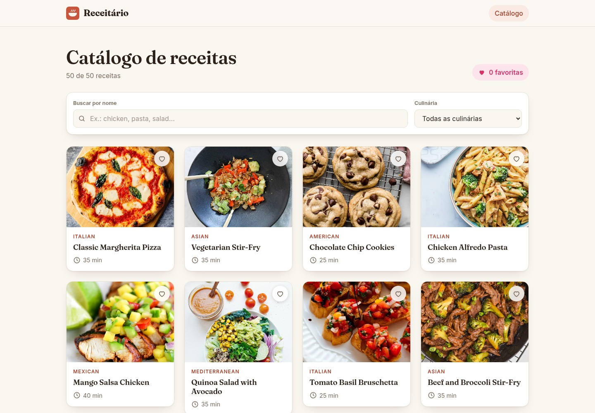

# Receitário

Catálogo de receitas em **React + Vite + TypeScript** que consome a API pública
[DummyJSON](https://dummyjson.com/docs/recipes). Projeto do Checkpoint 5 — Frontend · FIAP · 2º semestre.

**Deploy:** https://receitario-cp5.vercel.app

## Integrantes

Carlos Eduardo Oliveira Silva |569103
Allyson Victor | 571046
Kaique Ziantoni | 570294
Marcus Vinicius Costa | 573058
Silas Oliveira | 571506

## Funcionalidades

- **Catálogo (`/`)**: grid de cards com imagem, nome, culinária e tempo total
  (`prepTimeMinutes + cookTimeMinutes`, calculado no front), busca por nome e filtro por culinária
  funcionando em conjunto, botão de favoritar em cada card e contador "N favoritas" no topo.
- **Detalhe (`/receitas/:id`)**: imagem, ingredientes, modo de preparo e tempos de preparo,
  cozimento e total; mensagem amigável quando a receita não existe (API responde 404).
- **404 (`*`)**: mensagem de página não encontrada com link de volta ao catálogo.
- Lista de culinárias do filtro montada a partir dos dados da API, sem valores escritos à mão.
- Estados de carregamento (skeleton), erro (com "tentar novamente") e lista vazia (com "limpar filtros").

## Tecnologias

- React 19 + TypeScript
- Vite
- React Router
- CSS Modules
- Deploy na Vercel (`vercel.json` com rewrite para SPA)

